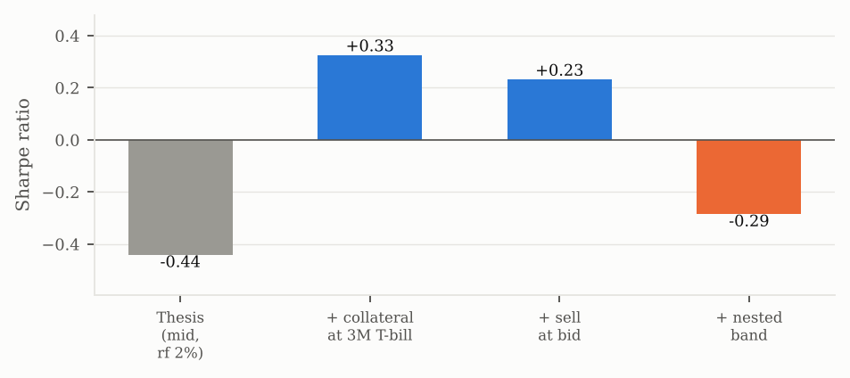
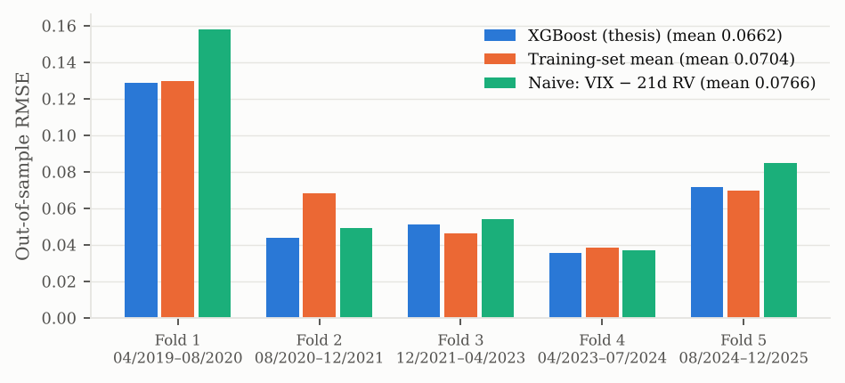
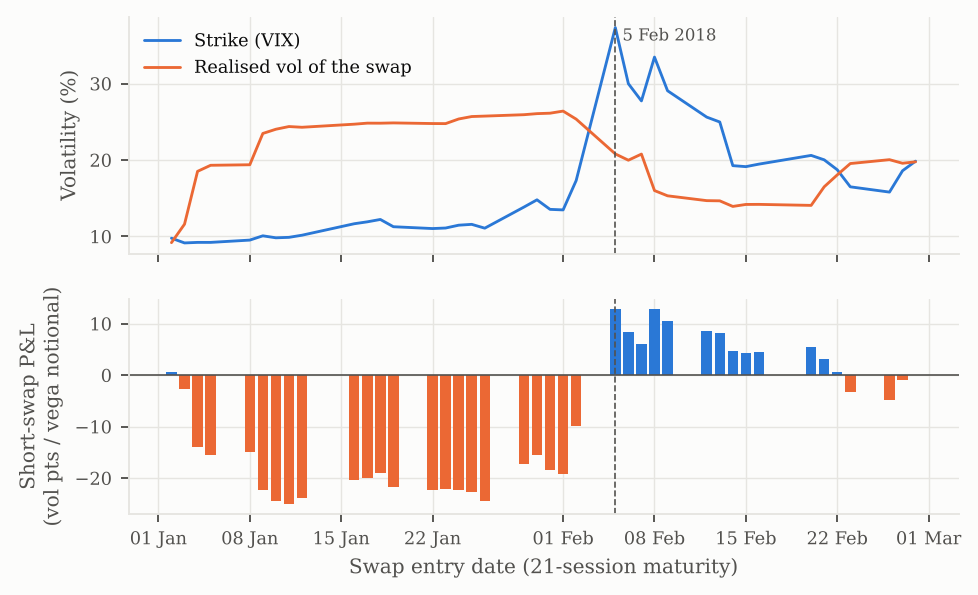

# Forecasting and trading the S&P 500 variance risk premium

**Can a gradient-boosting forecast of the variance risk premium (VRP) improve a delta-hedged short-volatility strategy on SPX options, net of costs and out of sample?**

**Paper:** [English (PDF)](paper/en/vrp_en.pdf) · [Español (PDF)](paper/es/vrp_es.pdf). It is a revised and extended version of my MSc thesis (Universidad Rey Juan Carlos, 2026, graded 10/10).

**Short answer: not yet.** The premium is real and can be harvested, and the forecast beats naive baselines on average. But the forecast never changes a trading decision. What drives the result is the hedge band and the collateral accounting, not the signal, and with 6.7 years of data no difference between strategies is statistically significant.

## Headline results

| | |
|---|---|
| **VRP is persistent** | VIX/100 exceeded the subsequent 21-day realised vol on **87.4 %** of days, 2018–2025 (mean **4.95 vol pts**). |
| **Forecast edge is modest and not significant** | Out-of-sample RMSE **0.0662** vs **0.0704** for the training mean (−6 %), but Diebold–Mariano **p = 0.27** on squared error. With nested CV: 0.0675. The model wins in 3 of 5 folds. |
| **The signal never reaches the trade** | All 1,659 forecasts are positive, so the ML strategy *is* "always sell". The forecast does not rank trade P&L either (Spearman **0.05**, p = 0.33). |
| **Accounting and hedging dominate** | Always-sell delta-hedged straddle, Apr 2019 – Dec 2025: Sharpe **−0.44** as in the thesis (cash idle, 2 % rf). It rises to **+0.23** once collateral earns the 3M T-bill and options are sold at the bid. It falls to **−0.29** when the hedge band is chosen out of sample instead of in sample. |



> **Correction to the thesis.** The thesis reported that the model beat a naive systematic rule (+5.95 % vs +3.89 %, 64 vs 76 trades). The comparison was not like-for-like. The 76 includes 14 trades opened before the evaluation window: inside the window it is 64 vs 62. The ML strategy reproduces exactly as an unconditional seller. See §5.4 of the paper and [`reports/extensions/strategies_thesis_settings.csv`](reports/extensions/strategies_thesis_settings.csv).

## Data

| Source | Series | Use |
|---|---|---|
| ThetaData (Options Standard) | SPX **monthly** options (third-Friday expirations): end-of-day quotes, greeks, IV, open interest | Option features, trade selection, mark-to-market |
| Stooq (yfinance fallback) | SPX daily OHLC | Realised-vol estimators, delta hedge, variance swaps |
| FRED | VIXCLS, DGS3MO, DGS10 | Implied vol (MFIV), rates, collateral interest |
| yfinance | CBOE SKEW | Tail-risk feature |

- **Sample:** 2 Jan 2018 – 31 Dec 2025: 2,011 sessions and 96 monthly expirations.
- **Cleaning:** 341,094 option rows after the filters below.
  - volume > 0, open interest ≥ 100
  - 0 < bid < ask, relative spread ≤ 20 %
  - 15–45 DTE, moneyness 0.85–1.15
- **2021:** missing from the option data, but covered by the variance-swap analysis.
- **Vendor data is not redistributed.** `scripts/download_data.py` rebuilds it with your own API keys.

## Methodology

- **Target:** `VRP_t = VIX_t/100 − RV_YZ(t, t+21]`, implied vol minus Yang–Zhang realised vol over the next 21 sessions. VIX/100 *is* the 30-day model-free implied vol, the square root of the replicated variance-swap strike (Carr & Wu, 2009). `vrp.variance.mfiv_from_strip` implements the strip replication and is unit-tested.
- **22 features**, all known at the close of day *t*:
  - realised vol: close-to-close, Parkinson, Garman–Klass, Yang–Zhang;
  - option microstructure: ATM IV, 25-delta skew, put-call ratios, IV rank and percentile;
  - rates, VIX, SKEW and SPX momentum.
- **Models:** XGBoost and LightGBM with a Huber objective (δ = 0.02) and a seeded random search over 40 grid points.
- **Purged walk-forward CV:** 5 expanding folds. A gap of 21 sessions (purge) plus 5 (embargo) separates training from test (López de Prado, 2018). **Nested** version: the model family and hyper-parameters are chosen on an inner purged CV inside each training block.
- **Forecast tests:**
  - baselines: training-set mean, and naive VIX − trailing RV;
  - Diebold–Mariano with Newey–West (20 lags) and the HLN correction.
- **Strategy:** when flat and the signal is on, sell one ATM SPX straddle (~30 DTE). It is marked daily at chain quotes and delta-hedged with the index whenever |net delta| exceeds a band. Costs are $1 per leg and 1 bp per hedge trade, and positions are cash-settled at expiry.
  - "Rigorous" configuration: sell at the bid, collateral earns the 3M T-bill, and the band is chosen in each fold from prior data only.
- **Using the forecast's magnitude:** trade only if the forecast exceeds the training-block median VRP, or size the position proportionally to the forecast.
- **Synthetic variance swaps:** short a 21-session swap struck at the VIX. The P&L per unit of vega notional is `(K² − RV²)/(2K)`. Results are averaged over all 21 entry calendars, uncapped and capped at 2.5 K.
- **Inference:** stationary block bootstrap (Politis & Romano, 1994) of Sharpe ratios and of paired Sharpe differences.



| Rigorous configuration, band 0.50 | Sharpe | Max DD | Trades |
|---|---|---|---|
| Always sell | 0.23 | −4.7 % | 64 |
| ML > training median | 0.22 | −3.3 % | 30 |
| ML sized by forecast | 0.20 | −5.3 % | 64 |
| Naive > training median | 0.35 | −4.3 % | 42 |

In the bootstrap (rigorous configuration, nested band), none of the Sharpe differences against "always sell" is significant: every 95 % CI includes 0. In variance swaps, filtering on the forecast lifts the uncapped Sharpe from 0.31 to 0.50 but not the capped one (0.81 → 0.70). The naive filter does as well or better in both cases.

**Volmageddon.** A one-month variance swap sold on 22 Jan 2018 at a strike of 11.0 realised 24.8. It lost **22.3 vol pts per unit of vega notional**, about 20 months of average premium. The loss came from selling volatility when it was cheap, not from the 5 February session itself.



## Limitations

- **Pricing near expiry:** the last 15 days of each straddle (peak gamma) are priced with Black–Scholes at the last IV, because the cleaned chain covers 15–45 DTE. Tail risk is probably understated. Fixing this needs 0–45 DTE quotes.
- **Execution:**
  - hedging at 1 bp with no market impact;
  - settlement at the expiry-day close, not the SPX SOQ;
  - fixed size: one contract, about 0.3× notional per leg on $1 M.
- **Sample:** a single 6.7-year, bull-market-dominated path with 64 trades and about 80 months. 2021 has no option data, and it was the best year for the variance swap.
- **Design choices:** nested CV removes selection bias in the hyper-parameters and the band, but the overall design (features, horizon, loss) was built with knowledge of the sample.
- **Reproducibility:** XGBoost is not bit-identical across platforms. A Linux retrain moves fold RMSE by ≤ 0.003, but all predictions stay positive and the backtest is unchanged. The frozen thesis predictions in `reports/thesis/` reproduce the thesis numbers exactly.

**Next:**
- forecast the hedged trade's P&L, or classify negative-premium regimes, instead of the vol spread;
- volatility-targeted sizing;
- 0–45 DTE chains and recovery of 2021;
- SPXW weeklies for more independent trades.

## Reproduce

```bash
conda env create -f environment.yml && conda activate vrp
cp .env.example .env                        # add THETADATA_API_KEY and FRED_API_KEY
python scripts/download_data.py             # ~19 h for the option chains; resumable
python scripts/run_pipeline.py              # ~40 s: thesis results -> reports/results, reports/figures
python scripts/run_extensions.py            # ~2 min (+5 min with --rerun-nested): paper results -> reports/extensions
python paper/make_figures.py --lang en      # paper figures (also --lang es)
cd paper/en && latexmk -pdf vrp_en.tex      # paper PDF (paper/es for Spanish)
pytest                                      # unit tests
```

Tested with Python 3.13, pandas 3.0, NumPy 2.5, XGBoost 3.4, LightGBM 4.7 and scikit-learn 1.9. All seeds are fixed at 42. `download_data.py` was refactored after the thesis and has not been re-run against the live ThetaData API.

```
src/vrp/      data · variance · features · models · backtest · varswap · evaluation · plots
scripts/      download_data · run_pipeline (thesis) · run_extensions (paper)
notebooks/    01_data · 02_vrp_stylised_facts · 03_ml_forecasting · 04_volmageddon
paper/        en/ · es/ (LaTeX + PDF) · figures/ · make_figures.py · refs.bib
reports/      results/ (thesis pipeline) · extensions/ (paper) · thesis/ (frozen thesis predictions) · figures/
tests/        estimators, MFIV replication, purged CV, pricing, metrics
```

## Thesis

*Arbitraje estadístico de volatilidad: modelado del Variance Risk Premium mediante Machine Learning*. Borja Izquierdo Piñero, Máster en Asesoramiento y Planificación Financiera, Universidad Rey Juan Carlos, July 2026. The original thesis is not published; the paper above supersedes it.

MIT licence. Not investment advice.
